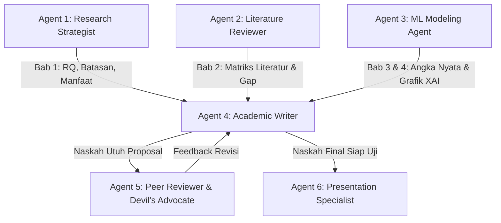

# AGENTS.md — Master Architecture, Workflow & MCP Orchestration

> **Proyek Skripsi**: Pengembangan Model Deteksi Fraud Klaim Asuransi Kendaraan Bermotor Berbasis LightGBM dengan Optimasi Hyperparameter Menggunakan Optuna  
> **Program Studi**: Sarjana Sistem Informasi, FMIPA Universitas Negeri Semarang (UNNES)  
> **Panduan Utama**: [`project_context.md`](project_context.md) & [`research_constraints.md`](research_constraints.md)  
> **Paper Acuan**: Ding et al. (2025), *Automobile Insurance Fraud Detection Based on PSO-XGBoost Model and Interpretable Machine Learning Method*, Insurance Mathematics and Economics (Elsevier).

---

## 🎯 Peta Ekosistem Proyek

Proyek ini menggunakan arsitektur modular yang mengintegrasikan panduan institusional UNNES, keahlian metodologis bertahap (*skills*), dokumen penelitian terstruktur (*research/*), dataset lokal (*data/*), toolchain machine learning (*src/*), serta presentasi (*presentation/*):

```
skripshit-asuransi/
├── project_context.md                     # Ground truth, judul, fenomena, RQs, & batasan
├── research_constraints.md                # Pemetaan 11 poin revisi arahan dosen pembimbing
├── AGENTS.md                              # Master architecture, workflow & integrasi MCP
├── requirements.txt                       # Dependensi Python (LightGBM, Optuna, SHAP, dll.)
├── LOGBOOK_BIMBINGAN.md                   # Catatan log bimbingan skripsi terstruktur
├── README.md                              # Ringkasan proyek & status riset
├── generate_docx.py                       # Skrip generator naskah proposal Word (format resmi UNNES)
├── generate_reading_activities.py         # Skrip pengisi jurnal membaca artikel acuan (Word)
│
├── references/                            # Rujukan resmi & naskah acuan
│   ├── 2026 - Template Proposal Skripsi.docx # Template resmi Word UNNES 2026
│   ├── Template-Proposal-Skripsi-2026.md     # Template proposal skripsi resmi UNNES 2026 (Markdown)
│   ├── Template Reading Activities.docx      # Template Word membaca artikel acuan
│   ├── LOGBOOK BIMBINGAN.docx                # Template Word logbook bimbingan
│   ├── Template-Jurnal.docx                  # Template Word naskah publikasi jurnal
│   ├── RPS-Metopen.md                        # Panduan kurikulum metode penelitian SI UNNES
│   ├── skripsi_references.bib                # Database sitasi BibTeX standar APA Edisi ke-7
│   └── pdfs/                                 # PDF paper acuan bereputasi (Ding et al., 2025)
│
├── skills/                                # Keahlian metodologis lokal (Start to End)
│   ├── research-methodology/SKILL.md      # [START] Tahap 1: Latar Belakang (tanpa gambar), Batasan, RQ, Manfaat
│   ├── literature-review/SKILL.md         # [PHASE 2] Tahap 2: Matriks Literatur, Kritik Hyperparameter, Gap & Novelty
│   ├── dataset-ml/SKILL.md                # [PHASE 3] Tahap 3: Dataset 11.565 klaim, LightGBM, Optuna TPE, TreeSHAP
│   ├── ml-modeling-agent/SKILL.md         # [MODELING] Tahap 3 Teknis: Otomasi preprocessing, Optuna, benchmarking
│   ├── proposal-reviewer/SKILL.md         # [END] Tahap 4: Audit Naskah Lengkap Bab 1-3 & Template UNNES 2026
│   └── bolt-slides/                       # [PRESENTASI] Slide deck interaktif seminar proposal (React + Vite)
│
├── templates/                             # Template naskah akademis siap pakai
│   ├── imrad_template.md                  # Format naskah empiris IMRaD
│   ├── bilingual_abstract_template.md     # Template abstrak bilingual (Indonesia & Inggris)
│   ├── peer_review_report_template.md     # Template laporan review 5-sudut pandang
│   └── revision_response_template.md      # Template matriks respon revisi dewan penguji
│
├── research/                              # Modul dokumen naskah penelitian
│   ├── problem.md                         # Subbab 1.1: Latar belakang deduktif (tanpa gambar)
│   ├── research-question.md               # Subbab 1.2 & 1.3: Batasan masalah (poin) & 3 RQ terukur
│   ├── literature-matrix.md               # Subbab 1.6 & 2.1: Matriks penelitian terdahulu (Tabel 1.1)
│   ├── research-gap.md                    # Subbab 1.6 & 2.4: Research gap & novelty statement
│   ├── dataset.md                         # Subbab 3.1 & 3.2: Spesifikasi data 11.565 baris & rekayasa fitur
│   ├── methodology.md                     # Subbab 3.3–3.5: Pipeline CRISP-DM, LightGBM, Optuna, & TreeSHAP
│   ├── defense-qa.md                      # Bank tanya-jawab antisipasi pertanyaan seminar proposal
│   └── proposal.md                        # Naskah lengkap proposal skripsi (Bab 1, Bab 2, Bab 3)
│
├── data/                                  # Penyimpanan data lokal
│   ├── raw/fraud_oracle.csv               # Data mentah klaim asuransi (15.420 baris, 33 kolom)
│   └── processed/                         # Data hasil pembersihan, train/test split, & matriks evaluasi
│
├── presentation/                          # Aplikasi slide deck interaktif seminar proposal (React + Vite)
└── src/                                   # Skrip pipeline pemodelan & visualisasi
    ├── preprocess.py                      # Pembersihan data, imputasi, dan Z-score scaling
    ├── tune_optuna.py                     # Optimasi hyperparameter LightGBM via Optuna (TPE)
    ├── evaluate.py                        # Evaluasi komparatif model vs baseline & Type II error
    └── explain_shap.py                    # Analisis interpretabilitas global & lokal (TreeSHAP)
```

---

## 👥 Regu Agen Khusus (Specialized Agent Squad & Roles)

Proyek ini mendefinisikan 6 peran agen spesialis yang dapat didelegasikan secara mandiri tanpa harus mencampuradukkan penulisan naskah dengan koding teknis:



| ID Agen | Nama Peran | Skill Utama | Tanggung Jawab & Kontrak Keluaran |
|---|---|---|---|
| **Agent 1** | **Research Strategist** | `research-methodology` & `academic-paper` (Phase 0-1) | Memformulasikan Latar Belakang deduktif **tanpa gambar**, Batasan Masalah dalam **poin-poin**, tepat **3 Research Questions**, dan tepat **2 Manfaat Penelitian**. Menjamin naskah mematuhi `research_constraints.md`. |
| **Agent 2** | **Literature Reviewer** | `literature-review`, `deep-research`, `novelty-assessment` | Menelaah paper acuan Ding et al. (2025) dan minimal 7 paper jurnal bereputasi. Menyusun Tabel 1.1 Matriks Penelitian Terdahulu dan membedah kelemahan optimasi hyperparameter PSO vs Optuna TPE. |
| **Agent 3** | **ML Modeling Agent** | `skills/ml-modeling-agent`, `skills/dataset-ml` | Mengelola dataset 11.565 baris, rasio 1:16, mengeksekusi pipeline machine learning di `src/`, tuning Optuna TPE, benchmarking baseline, dan menghasilkan plot TreeSHAP resolusi tinggi dengan protokol **Zero Data Fabrication**. |
| **Agent 4** | **Academic Writer** | `academic-paper` (Phase 2-5), `citation-management` | Mengompilasi seluruh modul menjadi naskah lengkap proposal skripsi Bab 1, 2, dan 3 berpedoman pada `references/Template-Proposal-Skripsi-2026.md`, format sitasi APA Edisi ke-7, dan ketiadaan frasa AI klise (*anti-AI slop*). |
| **Agent 5** | **Peer Reviewer & Devil's Advocate** | `proposal-reviewer`, `academic-paper-reviewer` | Mengaudit proposal secara objektif melalui 5 sudut pandang (Journal-Fit, Methodology, Domain, Perspective, dan Devil's Advocate) untuk menembak celah logika sebelum naskah diajukan ke pembimbing/penguji. |
| **Agent 6** | **Presentation Specialist** | `bolt-slides`, `slide-generation` | Menyiapkan slide presentasi interaktif di `presentation/` dan menyusun panduan antisipasi pertanyaan sidang di `research/defense-qa.md`. |

---

## 🛠️ Integrasi MCP Servers (Model Context Protocol)

| MCP Server | Peran & Penggunaan Utama | Alat Utama |
|---|---|---|
| **`context7`** | Mengambil dokumentasi resmi dan sintaks API terkini untuk pustaka machine learning: sintaks LightGBM, konfigurasi studi Optuna (TPE Sampler & Median Pruner), Scikit-learn cross-validation, dan TreeSHAP visualizers. Mencegah halusinasi parameter usang. | `query-docs`, `resolve-library-id` |
| **`treg`** | Menelusuri metadata literatur ilmiah, mengecek DOI aktif, mengambil abstrak paper bereputasi di Scopus/IEEE/Elsevier, serta pengayaan data eksternal. | `treg_*` |
| **`ai_memory`** | Menyimpan memori persisten jangka panjang mengenai keputusan desain riset, catatan bimbingan dosen, serta checkpoint antar-sesi kerja agent. | `memory_query`, `memory_write_page`, `memory_briefing` |
| **`browser-harness`** | Otomasi browser jika diperlukan verifikasi repositori Kaggle, ScienceDirect, atau portal akademik resmi. | `browser_*` |

---

## 🛡️ Aturan Emas Kolaborasi (Master Directives)

1. **Anti-AI Slop**: Naskah harus bebas dari kata-kata klise generik (*"seamlessly"*, *"cutting-edge"*, *"pioneering"*, *"spearheaded"*). Setiap kalimat harus berupa fakta, keputusan arsitektur, bukti sitasi ilmiah, atau risiko metodologis.
2. **Kepatuhan Arahan Dosen Pembimbing**: 11 poin pada `research_constraints.md` bersifat mutlak. Jika terdapat kontradiksi, arahan dosen pembimbing selalu diprioritaskan.
3. **Pemisahan Peran Naskah vs Koding**: Penulisan naskah ilmiah dan eksperimen machine learning dijalankan oleh agen yang memiliki kontrak terpisah. Tidak perlu memaksakan membuat notebook Jupyter jika fokus kerja sedang berada pada formulasi naskah atau bimbingan bab per bab.
4. **Reproducibility**: Seluruh hasil eksperimen, tabel perbandingan, dan grafik SHAP harus dapat direproduksi melalui kode Python di folder `src/`.
