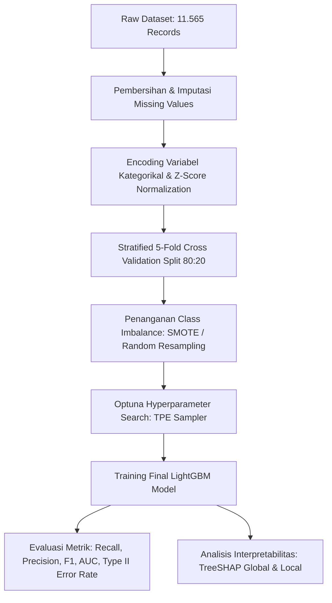

# Skill: Dataset & Machine Learning (Tahap 3: Data, Model & Evaluasi)

Skill ini memandu pelaksanaan eksperimen teknis penelitian, mulai dari kurasi dataset di direktori `data/`, perancangan pra-pemrosesan, optimasi hyperparameter **LightGBM** dengan **Optuna (TPE)**, pengujian terhadap model baseline, hingga visualisasi interpretabilitas **TreeSHAP**.

---

## ⚠️ Aturan Kritis Peneliti (*Zero-Hallucination Policy*)
Sesuai amanat [`project_context.md`](../../project_context.md):
1. **Dilarang Keras Mengarang Data/Hasil**:
   * ❌ DILARANG mengarang dataset fiktif seolah-olah data riil.
   * ❌ DILARANG mengarang angka metrik (Akurasi, Presisi, Recall, F1, Type II error) atau hasil evaluasi.
   * ✅ Seluruh angka dalam tabel bab 4 atau modul hasil eksperimen harus bersumber dari eksekusi kode Python nyata di folder `src/`.
2. **Kepatuhan Etika & Privasi**:
   * Data sekunder tidak memuat data identitas sensitif (PII) riil.

---

## 📁 Spesifikasi Dataset (`research/dataset.md` & `data/`)

### 1. Karakteristik Dataset Acuan (Ding et al., 2025)
* **Sumber Data**: Gabungan data investigasi fraud asuransi, institusi asuransi, dan repositori Kaggle/Oracle (*Automobile Insurance Claim Fraud*).
* **Total Records**: **11.565 data klaim**.
* **Distribusi Kelas**:
  * Kelas Positif (`FraudFound_P = 1`): **685 klaim** (5,92%) — Kasus Fraud (Minoritas).
  * Kelas Negatif (`FraudFound_P = 0`): **10.880 klaim** (94,08%) — Kasus Normal (Mayoritas).
  * **Rasio Imbalance**: **~1 : 16**.

### 2. Atribut Fitur Utama (33 Fitur Penjelas)
Mengacu pada Tabel 2 Ding et al. (2025):
* `FraudFound_P` (Target biner: 0 atau 1)
* `ClaimSize` (Besaran nominal klaim — fitur paling signifikan menurut SHAP)
* `VehicleCategory` (Kategori kendaraan: Sedan, Sport, Utility, dll.)
* `VehiclePrice` (Rentang harga kendaraan)
* `Fault` (Pihak yang bersalah dalam kecelakaan: Policy Holder vs Third Party)
* `Age` (Usia pemegang polis / pengemudi)
* `Sex`, `MaritalStatus` (Karakteristik demografis)
* `PolicyType` (Jenis polis asuransi)
* `Deductible` (Nilai potongan yang ditanggung tertanggung)
* `PastNumberOfClaims` (Riwayat jumlah klaim sebelumnya)
* `AgeOfVehicle` (Usia kendaraan saat insiden)
* `PoliceReportFiled` (Apakah laporan polisi telah dibuat: Yes/No)
* `WitnessPresent` (Keberadaan saksi mata: Yes/No)
* `NumberOfCars` (Jumlah kendaraan yang terlibat)
* `Make` (Merk/pabrikan kendaraan)
* `AccidentArea` (Area kecelakaan: Urban vs Rural)

---

## 🛠️ Pipeline Pemodelan CRISP-DM (`research/methodology.md` & `src/`)

### 1. Preprocessing Data
* **Missing Value Imputation**: Imputasi nilai hilang dengan mean/median untuk variabel kontinu dan modus untuk variabel kategorikal.
* **Categorical Encoding**: Label/Ordinal Encoding untuk variabel bertingkat dan One-Hot Encoding untuk variabel nominal.
* **Feature Standardization**: Z-Score Normalization:
  $$x^* = \frac{x - \mu}{\sigma}$$

### 2. Penanganan Class Imbalance (Rasio 1:16)
* Pendekatan Level Data: Kombinasi *Random Under-Sampling* pada kelas mayoritas dan *Random Over-Sampling* / *SMOTE (Synthetic Minority Over-sampling Technique)* pada kelas minoritas.
* Pendekatan Level Algoritma: Pengaturan hyperparameter `scale_pos_weight` pada LightGBM untuk memberikan penalti lebih besar pada misklasifikasi kelas fraud.

### 3. Optimasi Hyperparameter via Optuna (TPE)
Ruang pencarian hyperparameter LightGBM yang diuji:
* `num_leaves`: `[15, 255]`
* `max_depth`: `[3, 12]`
* `learning_rate`: `[0.01, 0.3]` (log scale)
* `n_estimators`: `[50, 500]`
* `min_child_samples`: `[10, 100]`
* `subsample` (*bagging_fraction*): `[0.5, 1.0]`
* `colsample_bytree` (*feature_fraction*): `[0.5, 1.0]`
* `reg_alpha` ($L_1$) dan `reg_lambda` ($L_2$): `[1e-8, 10.0]` (log scale)

**Konfigurasi Optuna**:
* Objective Function: Memaksimalkan F1-Score atau meminimalkan *Type II Error Rate* pada validasi 5-fold.
* Sampler: `TPESampler(seed=42)`
* Pruner: `MedianPruner(n_startup_trials=10, n_warmup_steps=15)`

### 4. Metrik Evaluasi Komparatif
Sesuai Tabel 5 & 6 paper acuan:
* $\text{Accuracy} = \frac{TP + TN}{TP + TN + FP + FN}$
* $\text{Recall (Sensitivity)} = \frac{TP}{TP + FN}$ (Sangat krusial untuk menangkap seluruh fraud)
* $\text{Precision} = \frac{TP}{TP + FP}$
* $\text{Type II Error Rate (False Negative Rate)} = \frac{FN}{TP + FN} = 1 - \text{Recall}$ (Target utama minimalisasi)
* $\text{F1-Score} = 2 \times \frac{\text{Precision} \times \text{Recall}}{\text{Precision} + \text{Recall}}$
* $\text{ROC-AUC}$ & $\text{PR-AUC}$

### 5. Interpretabilitas TreeSHAP
* **Global Importance**: Menghitung rata-rata nilai absolut SHAP ($|\phi_j|$) untuk setiap fitur.
* **Summary Plot**: Visualisasi pengaruh positif/negatif masing-masing nilai fitur terhadap probabilitas fraud.
* **Interaction Dependence Plot**: Menganalisis interaksi non-linear antara pasangan fitur dominan (misal: `VehicleCategory` vs `VehiclePrice`).

---

## ✅ Kriteria Verifikasi Tahap 3
- [ ] Detail dataset 11.565 baris dan rasio 1:16 terdefinisi lengkap di `research/dataset.md`.
- [ ] Toolchain (Python, LightGBM, Optuna, Scikit-learn, SHAP) tercantum jelas.
- [ ] Pipeline pemodelan dan ruang hyperparameter Optuna terdefinisi di `research/methodology.md`.
- [ ] Skrip reproduksi siap di folder `src/`.
